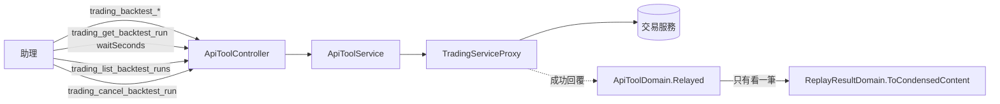

# 回測改為送出後查看（外掛）— Architecture Design

**Status:** Confirmed（autonomous run — decisions recorded below）
**Source PRD:** `.sdd/2026-10-10-background-backtest-runs/PRD.md`
**Tech context:** Go · MCP 外掛（`modelcontextprotocol/go-sdk` v1.8.0，Streamable HTTP）· 能力清單即功能（`cmd/server/tool_catalog*.go` 宣告，`ApiToolDomain` 單一路徑轉達）· 交易服務路由以 `go-trading/.sdd/2026-10-10-background-backtest-runs/ARCH.md` 為準

---

## 1. Design Goal & Guiding Principle

- **In one sentence:** 四件重演能力的宣告拿掉「等比較久」與「精簡」、說明改成「送出就回輪次」；新增看一筆（可順便等、回來才精簡）、列出、取消三件能力；MCP handler 改成 `Stateless: true`，讓任何一次呼叫落在哪一份外掛都一樣。
- **Guiding principle:** **能力只是宣告，規則全在交易服務。** `internal/` 只動一處：`ApiToolDomain` 的 `CondensingReplayResults()` 從四件重演搬到「看一筆回測輪次」——精簡的規則（`ReplayResultDomain`）一行不改，只是精簡的對象變成輪次明細裡的 `result`。

---

## 2. Change Scope

| Area | Action | What / Why |
| :--- | :--- | :--- |
| `cmd/server/tool_catalog_strategy.go` | **Modify** | 四件重演宣告：拿掉 `.Waiting(replayWaitLimit).CondensingReplayResults()`；說明改寫（見 §3）；新增 `backtestRunApiTools(replayWaitLimit)`：三件新能力 |
| `cmd/server/tool_catalog.go` | **Modify** | `apiToolCatalog` 加 `backtestRunApiTools(...)` |
| `internal/domain/models/domains/replay_result_domain.go` | **Modify** | `ToCondensedContent()` 多認得「輪次明細」形狀：頂層有 `result` 時精簡 `result` 裡的曲線與交易（含 `inSample`／`validation`），其餘欄位原樣；沒有 `result`（排隊中、進行中、失敗）原封轉交 |
| `cmd/server/dependencies.go` | **Modify** | `StreamableHTTPOptions{Stateless: true}`；拿掉 `SessionTimeout` |
| `cmd/server/config.go` | **Modify** | 移除 `IdleConnectionTimeout` / `IDLE_CONNECTION_TIMEOUT_MINUTES`（無狀態下沒有連線可放掉） |
| 測試 | **Modify / Add** | `tool_catalog_test.go` 的能力總表加三件；`TestOnlyTheReplaysWaitLonger` 改成「只有實盤 vs 回測兩件與看一筆回測輪次等比較久」；`TestOnlyTheReplaysCondenseWhatTheyHandOn` 改成只有看一筆回測輪次精簡；新 `tool_catalog_backtest_run_test.go` 釘住三件能力的路由、參數、說明句子；`replay_result_domain` 測試加輪次明細形狀；`config_test` 拿掉閒置逾時 |
| `README.md` | **Modify** | 四件重演改成送出就回；新一節「回測輪次」；環境變數表拿掉 `IDLE_CONNECTION_TIMEOUT_MINUTES`；多份外掛一節 |
| `TradingServiceProxy`、`ApiToolService`、`ApiToolController`、授權 | **Not touched** | 每一次呼叫本來就自帶 bearer，無狀態模式不影響 |
| 兩件實盤 vs 回測能力 | **Not touched** | 仍 `.Waiting(replayWaitLimit)`，交易服務那邊維持當場算 |

---

## 3. New Classes / Modules

沒有新型別。新增三筆宣告：

| 能力名稱 | 交易服務路由 | 參數 | 說明必須寫出的事 | Satisfies |
| :--- | :--- | :--- | :--- | :--- |
| `trading_get_backtest_run` | `GET /backtest-runs/{id}` | path `id`✔；query `waitSeconds`（0–60） | 回 `status`（queued／running／succeeded／failed／cancelled）、`progressPercent`、要跑什麼；succeeded 時 `result` 是精簡過的成績單（曲線 200 點＋`equityCurvePointTotalCount`、交易最近 100 筆＋`closedTradeTotalCount`、`inSample`／`validation` 各自照做、成績單數字不動）；failed 時 `failureReason` 照說，「超過時間上限」「被重新啟動打斷」不是腳本壞了；`waitSeconds` 最多 60，輪次提前結束就提前回；不是自己的 404 | US-02 全部、US-04 排隊中的說法 |
| `trading_list_backtest_runs` | `GET /backtest-runs` | query `status`、`strategyScriptId`、`tradingStrategyId`、`limit`（預設 20、最多 200） | 新到舊；回覆時說出 `totalCount`；每筆帶狀態、要跑什麼、送出時間、`totalReturnRate`／`maximumDrawdown`／`tradeCount`（完成才有）；使用者問以前跑過的要用這件找，不重跑 | US-03 列出、US-03 使用者問昨天跑過的 |
| `trading_cancel_backtest_run` | `POST /backtest-runs/{id}/cancel` | path `id`✔ | 只能取消 queued／running；已結束 409 原話帶回 | US-03 取消 |

四件重演能力的說明改寫要點（共用一段 `backgroundReplayNote` 取代現在的「整體時間上限」與「精簡」兩段）：

- 「**它不等算完**——要求合法就立刻回一筆回測輪次（`id`、`status`），請拿 `id` 用 `trading_get_backtest_run` 看進度與成績單；短的幾秒，四年份的 1 小時刻度可能要幾分鐘。**把輪次編號說給使用者**。」
- 「`status` 是 queued 時代表前面還有在跑的，**會自動開始，不要重送**；被拒『你同時最多 N 筆』時等一筆結束或取消一筆。」
- 「回測有背景時間上限（預設三十分鐘），超過會是 failed、原因『超過時間上限』。」
- 既有的「成績單怎麼讀」那幾段（交易筆數、停損出場、成本、短線統計）保留，但開頭改成「拿到成績單後……」。

`trading_get_backtest_run` 宣告為 `.Waiting(replayWaitLimit).CondensingReplayResults()`：等比較久是因為它可能順便等 60 秒；精簡是因為它回的是成績單。

---

## 4. Modified Components

| Component | Current role | Change needed |
| :--- | :--- | :--- |
| `ReplayResultDomain.ToCondensedContent` | 精簡頂層的曲線與交易 | 頂層沒有 `equityCurve` 但有 `result` 物件時，對 `result` 做同一套；都沒有時原封 |
| `buildMcpServer` / `dependencies.go` | 有狀態的 Streamable HTTP | `Stateless: true`；無 `SessionTimeout` |
| `config.go` | 讀閒置逾時 | 刪除該欄位與環境變數 |
| `README.md` | 文件 | 見 §2 |

---

## 5. Component Relationships

---

## 6. Extensibility & Handoff Notes

- **Most likely next requirement:** 交易服務加「重跑一筆輪次」或「批次送出」。
- **Where it lands:** 各加一筆宣告；若回的是輪次明細就掛 `.CondensingReplayResults()`。
- **Do not hardcode:** `waitSeconds` 的上限由交易服務決定，外掛只在說明寫「最多 60」。
- **Known debt / deferred:** 無狀態模式下 server→client 的通知不可用；本外掛從未使用，無影響。

---

## 7. Traceability

| PRD Scenario | Fulfilled by |
| :--- | :--- |
| US-01 送出就回／輸入不變／拒絕原話／不再等更久 | 四件重演宣告（參數不動、拿掉 `.Waiting`）＋ `backgroundReplayNote` |
| US-02 完成帶精簡成績單／順便等／等滿回狀態／最多 60／失敗原因／別人的 | `trading_get_backtest_run`（`.Waiting`、`.CondensingReplayResults`）＋ `ReplayResultDomain` 認得輪次明細 |
| US-03 列出／只看失敗／取消／已結束拒絕／問昨天跑過的 | `trading_list_backtest_runs`、`trading_cancel_backtest_run` 與其說明 |
| US-04 排隊中不叫重送／每人上限滿 | `backgroundReplayNote` |
| US-05 多份外掛／重新連線指引不變 | `Stateless: true`；授權路徑不變 |

---

## 8. Risks & Open Decisions

- 交易服務的 `GET /backtest-runs/{id}` 回應裡成績單欄位名定為 `result`（後端 ARCH `BacktestRunDetailDto`）；若實作時改名，精簡要跟著認。
- `Stateless` 模式下 Claude Code 既有的連線會在下一次呼叫時自動以無狀態方式繼續；不需要使用者重新連線。
