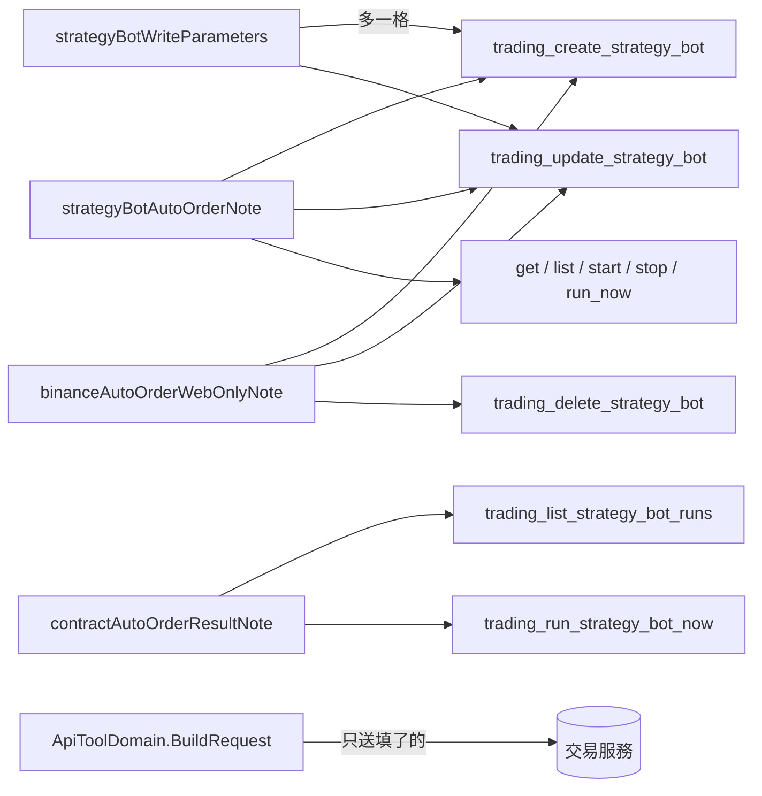

# 自動下單限價進場（外掛） — Architecture Design

**Status:** Confirmed
**Source PRD:** `.sdd/2026-10-12-auto-order-limit-entry/PRD.md`
**Tech context:** Go · MCP 外掛 · 能力清單即功能（`cmd/server/tool_catalog*.go` 宣告，`ApiToolDomain` 單一路徑轉達）

---

## 1. Design Goal & Guiding Principle

- **In one sentence:** 建立／改寫機器人多宣告一格 `autoOrderEntrySlippageTolerancePercentage`（body、字串精確小數、非必填）；
  機器人讀取能力的說明講出這一格；讀執行紀錄的能力講出 `autoOrder` 的整體結果、進場欄位與 `entryStatus`；
  刪除能力講出 409 `autoOrderEntryOutstanding` 的解法；把每一處「目前開著也還不會下單」改成實情。
- **Guiding principle:** **外掛不懂規則，只懂說明。** 轉達路徑已是「宣告了才送、不填就不送、回覆與拒絕原樣轉交」：
  - 不填容忍度 → `ToolArgumentsDomain.EncodedSubset` 不放進 body → 交易服務建立時給 0.1、改寫時保留原值。外掛**不設預設值**，否則改寫會把使用者的 0.3 蓋成 0.1。
  - 409 的 `{"message","reason"}` 由 `TradingServiceProxy.responseOf` 原樣當拒絕內容轉交 → 助理看得到 `reason`。
  - 執行紀錄的 `autoOrder` 原樣轉交。
  所以 `internal/` 一行不動；改的全是 `cmd/server/` 的宣告與說明常數，每一段說法只寫一次、由需要它的能力共用。

---

## 2. Change Scope

| Area | Action | What / Why |
| :--- | :--- | :--- |
| `cmd/server/tool_catalog_automation.go` `strategyBotWriteParameters` | **Modify** | 加 `autoOrderEntrySlippageTolerancePercentage`（`ToolParameterKindString`、非必填）：範圍 0～5（含）、百分點、建立預設 0.1、改寫不給即保留、限價＝參考價 ±、一個觸發間隔內沒成交就撤單、0 可能常常不成交、平倉不受影響、現貨無作用、只有停止的機器人改得動 |
| 同檔 `strategyBotAutoOrderNote` | **Modify** | 改成實情：合約機器人開著自動下單會真的在幣安開倉（有上限的限價進場單）與平倉（市價）、掛止損止盈；現貨仍不下單；另說回覆帶 `autoOrderEntrySlippageTolerancePercentage` |
| 同檔新常數 `contractAutoOrderResultNote` | **Add** | 讀執行紀錄的說明：`autoOrder` 只在排了自動下單的那一輪出現；`status` 六種（含 `unfilled`）；進場欄位；`entryStatus` 四種；滑價正數不利；舊紀錄沒有進場欄位。掛在 `trading_list_strategy_bot_runs` 與 `trading_run_strategy_bot_now`（後者指向讀紀錄） |
| `trading_update_strategy_bot` 說明 | **Modify** | 整份改寫的例外列成三樣：`marketDataKind`、自動下單、進場滑價容忍度 |
| `trading_delete_strategy_bot` 說明 | **Modify** | 講 409 `reason` 為 `autoOrderEntryOutstanding` 時的意思與解法（網頁關自動下單、等撤單、再刪；外掛不能關）＋ `binanceAutoOrderWebOnlyNote` |
| `cmd/server/dependencies.go` 伺服器說明 | **Modify** | 「目前開著也還不會下單」→ 實情；外掛讀得到也改得動容忍度 |
| 測試 `tool_catalog_binance_auto_order_test.go`、`dependencies_test.go` | **Modify** | 舊斷言釘的正是過時的話，改成釘新的說法並斷言舊句子不再出現在任何能力或伺服器說明裡 |
| 新測試 `tool_catalog_auto_order_limit_entry_test.go` | **Add** | 釘 PRD 情境：轉送／不轉送容忍度、說明的每一條要點 |
| `README.md`、`.sdd/UL-MAP.md` | **Modify** | 改過時的說法、加新詞 |
| `internal/` | **Not touched** | 轉達路徑已滿足；不加範圍檢查（規則屬交易服務） |
| 欄位型別 `number` | **Not chosen** | 交易服務兩種都收，但外掛其他精確小數（槓桿、資金、停損）一律字串；一致比較不會讓助理混淆 |

---

## 3. New Classes / Modules

無新型別。

| Name | Kind | Responsibility (purpose) | Collaborators | Satisfies (PRD scenario) |
| :--- | :--- | :--- | :--- | :--- |
| `contractAutoOrderResultNote` | 說明常數 | 一份「下單結果怎麼讀」的話，讀紀錄與立刻跑一輪共用 | — | 全部成交、部分成交、沒有成交、等待成交中 |
| `strategyBotAutoOrderEntryOutstandingNote`（併入刪除說明，不另立常數） | — | 只有刪除一處用 | — | 進場單還掛著 |

---

## 4. Modified Components

| Component | Current role | Change needed |
| :--- | :--- | :--- |
| `strategyBotWriteParameters()` | 建立與改寫共用的欄位 | 多一格容忍度 |
| `strategyBotAutoOrderNote` | 七件機器人能力共用的自動下單說法 | 改成實情、提容忍度 |
| `strategyBotApiTools()` | 九件機器人能力 | 改寫／刪除／讀紀錄／立刻跑的說明 |
| `buildMcpServer` `Instructions` | 外掛總說明 | 改過時句 |

---

## 5. Component Relationships

---

## 6. Extensibility & Handoff Notes

- **Most likely next requirement:** 現貨自動下單上線，或平倉也改限價、出場滑價容忍度。
- **Where it lands:** `strategyBotAutoOrderNote`（一句「現貨仍不下單」要拿掉）與 `contractAutoOrderResultNote`（多幾個欄位）；新設定就是 `strategyBotWriteParameters` 多一格。
- **How to add it:** 改常數、加一格宣告；轉達路徑不需改。
- **Do not hardcode:** 容忍度的預設值與範圍檢查——外掛只描述，交易服務決定。
- **Known debt / deferred:** 無。

---

## 7. Traceability

| PRD Scenario | Fulfilled by |
| :--- | :--- |
| 建立時沒提容忍度 | `BuildRequest` 不送未填欄位 + 欄位說明「不給即 0.1」 |
| 給了容忍度 | 宣告的容忍度欄位（body） |
| 容忍度 0 | 同上 + 欄位說明「0 可能常常不成交」 |
| 超出範圍 | 拒絕原樣轉交 + 欄位說明「0 到 5（含）、百分點」 |
| 改寫時沒給就保留 | `BuildRequest` 不送 + 改寫說明三個例外 |
| 查看一台 | 回覆原樣 + `strategyBotAutoOrderNote` |
| 全部／部分／沒有成交／等待成交中 | `contractAutoOrderResultNote` |
| 進場單還掛著 | 拒絕原樣轉交 + 刪除說明 |
| 沒有掛著的進場單 | 既有刪除路徑 |
| 列出機器人說實情 | `strategyBotAutoOrderNote` + 伺服器說明；測試斷言舊句子全面消失 |
| 要求打開自動下單 | 既有 `binanceAutoOrderWebOnlyNote`、無對應能力 |

---

## 8. Risks & Open Decisions

- **Risks:** 外掛先於交易服務部署時容忍度不生效；兩邊一起部署（交易服務 PR #104 已 merge）。
- **Open decisions:** 無。
