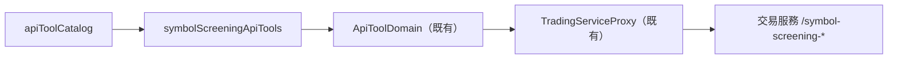

# 管理員標的篩選（外掛）— Architecture Design

**Status:** Confirmed（autonomous run — decisions recorded below）
**Source PRD:** `.sdd/2026-10-19-admin-symbol-screening/PRD.md`
**Tech context:** Go · MCP 外掛 · 能力清單即功能（`cmd/server/tool_catalog*.go` 宣告，`ApiToolDomain` 單一路徑轉達）· 交易服務路由以 `go-trading/.sdd/2026-10-19-admin-symbol-screening/ARCH.md` 與 `go-trading/README.md` 為準

---

## 1. Design Goal & Guiding Principle

- **In one sentence:** 新增一個能力清單檔 `cmd/server/tool_catalog_symbol_screening.go`，宣告九件標的篩選能力，接進 `apiToolCatalog`；「我是誰」的說明補一句會說出是不是管理員。
- **Guiding principle:** **能力只是宣告，規則與身分判斷全在交易服務。** `internal/` 一行不動：交易服務的拒絕（含 403「這是管理員功能」）本來就由 `TradingServiceProxy.responseOf` 以「交易服務拒絕」原話帶回，只有 401 會變成請使用者重新連線。沒填的選填格子本來就不送，所以「沒說的交給交易服務用預設值」不需要任何程式。

---

## 2. Change Scope

| Area | Action | What / Why |
| :--- | :--- | :--- |
| `cmd/server/tool_catalog_symbol_screening.go` | **Add** | `symbolScreeningApiTools(replayWaitLimit)`：九件能力宣告；共用說明常數 `administratorOnlyNote`、`symbolScreeningVerdictNote`；設定的寫入格子 `symbolScreeningProfileWriteParameters()`（建立與修改共用） |
| `cmd/server/tool_catalog.go` | **Modify** | `apiToolCatalog` 接上 `symbolScreeningApiTools(replayWaitLimit)`；`trading_get_current_user` 說明補「回覆會說出這個帳號是不是管理員（isAdmin）」 |
| `cmd/server/tool_catalog_test.go` | **Modify** | 能力總表加九件 |
| `cmd/server/tool_catalog_symbol_screening_test.go` | **Add** | 釘住九件能力的動作、路由、必填格子、清單原樣轉送、等待、只送填了的格子、說明必須講的句子 |
| `README.md` | **Modify** | 能力清單與一節「標的篩選（管理員）」 |
| `internal/**`（`ApiToolDomain`、`TradingServiceProxy`、`ApiToolService`、授權） | **Not touched** | 拒絕轉達、選填不送、等待上限都已是既有行為 |

---

## 3. New Classes / Modules

沒有新型別，新增九筆宣告：

| 能力名稱 | 動作與路由 | 參數 | Satisfies |
| :--- | :--- | :--- | :--- |
| `trading_list_symbol_screening_profiles` | read `/symbol-screening-profiles` | — | US-01 非管理員被擋 |
| `trading_get_symbol_screening_profile` | read `/symbol-screening-profiles/{id}` | path `id` | — |
| `trading_create_symbol_screening_profile` | submit `/symbol-screening-profiles` | body：`name`✔、`strategyScriptId`✔(integer)、`aggregationInterval`✔、`tradingMode`、`parameterValues`(array)、`leverage`／`entryCostPercentage`／`slippagePercentage`／`minimumAverageDailyQuoteVolume`（字串精確小數）、`historyDays`／`segmentCount`／`minimumTradeCount`(integer)、`baselineSymbols`(array) | US-04 全部 |
| `trading_update_symbol_screening_profile` | replace `/symbol-screening-profiles/{id}` | path `id` ＋ 同上（整份改寫：沒給的回到預設值，說明寫明） | — |
| `trading_delete_symbol_screening_profile` | remove `/symbol-screening-profiles/{id}` | path `id` | — |
| `trading_submit_symbol_screening_run` | submit `/symbol-screening-runs` | body：`profileId`✔(integer)、`symbols`✔(string，原樣) | US-01 送出、US-02 全部 |
| `trading_list_symbol_screening_runs` | read `/symbol-screening-runs` | query `status`、`limit` | — |
| `trading_get_symbol_screening_run` | read `/symbol-screening-runs/{id}` | path `id`；query `waitSeconds`；`.Waiting(replayWaitLimit)` | US-03 全部、US-05 |
| `trading_cancel_symbol_screening_run` | submit `/symbol-screening-runs/{id}/cancel` | path `id` | — |

說明共用段：
- `administratorOnlyNote`：只有管理員能用；不是管理員時交易服務回「這是管理員功能」，照原話轉達、**不要重試**，也不要教使用者怎麼變成管理員（只由營運者在系統外開通）。每件能力都附上。
- `symbolScreeningVerdictNote`（掛在看一筆篩選）：四種結論、兩道關卡、`findings` 裡的數字、組合貢獻（`gapReductionDays` 等）、`recommendationRank`、通過不是買賣建議。
- 送出篩選：照使用者貼的原樣放進 `symbols`（整理交給交易服務）；回一筆排隊中的篩選要把編號說給使用者；排隊中不要重送；同時只能一筆（被拒時等它結束或取消）。

---

## 4. Modified Components

| Component | Current role | Change needed |
| :--- | :--- | :--- |
| `apiToolCatalog` | 組出能力清單 | 多 append 一組 |
| `trading_get_current_user` | 我是誰 | 說明補一句 |

---

## 5. Component Relationships

---

## 6. Extensibility & Handoff Notes

- **Most likely next requirement:** 交易服務的篩選多了欄位或關卡（例如趨勢性格關）。
- **Where it lands:** `symbolScreeningProfileWriteParameters()` 加一格、`symbolScreeningVerdictNote` 加一句；能力總表測試與篩選測試各加一行。
- **Do not hardcode:** 預設值與門檻不寫進外掛說明以外的地方；說明提到的預設值以交易服務為準。
- **Known debt / deferred:** 無。

---

## 7. Traceability

| PRD Scenario | Fulfilled by |
| :--- | :--- |
| US-01 管理員透過助理送出篩選 | `trading_submit_symbol_screening_run` 宣告（路由、說明要求說出編號） |
| US-01 非管理員被擋下，助理照原話轉達 | 既有拒絕轉達 ＋ `administratorOnlyNote` |
| US-01 我是誰說出是不是管理員 | `trading_get_current_user` 說明 |
| US-02 大小寫與全形逗號原樣送出 | `symbols` 為字串、外掛不整理 |
| US-02 正好二十個標的照常送出 | 同上 |
| US-02 不允許的字元由交易服務拒絕並原話帶回 | 既有拒絕轉達 |
| US-03 說要等就把最多等幾秒帶給交易服務 | `trading_get_symbol_screening_run` 的 `waitSeconds` query ＋ `.Waiting` |
| US-03 沒說要等就立刻問 | 選填 query 不送 |
| US-04 只給必要項目 | 選填 body 不送 |
| US-04 明確給出等於預設的歷史天數 | 填了就送 |
| US-04 看盤間隔太細由交易服務拒絕 | 既有拒絕轉達 |
| US-05 看一筆篩選的說明教助理怎麼讀結論 | `symbolScreeningVerdictNote` |

---

## 8. Risks & Open Decisions

- **Risks:** 交易服務改欄位名時說明會過期；以宣告測試釘住路由與格子名稱。
- **Open decisions:** 無。修改設定採整份改寫（與交易服務一致），說明寫明沒給的會回到預設值。
