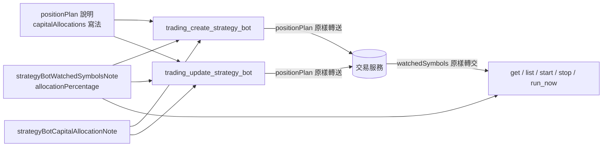

# 多標的機器人的資金分配（外掛） — Architecture Design

**Status:** Confirmed
**Source PRD:** `.sdd/2026-10-20-multi-symbol-capital-allocation/PRD.md`
**Tech context:** Go · MCP 外掛 · 能力清單即功能（`cmd/server/tool_catalog*.go` 宣告，`ApiToolDomain` 單一路徑轉達）

---

## 1. Design Goal & Guiding Principle

- **In one sentence:** `positionPlan` 多一個選填的 `capitalAllocations`（`[{symbol, allocationPercentage}]`），回覆的 `watchedSymbols[]` 多一個 `allocationPercentage`；
  外掛要讓助理懂：`capital` 是整台總金額（合約機器人是保證金）、每個標的只用 `capital × allocationPercentage ÷ 100`、不給即平均分配、合計 ≤ 100、
  修改時標的不變即保留、變了即重新平均——並把上一刀「每個標的各自照整份算、總曝險 N 倍」的說法換掉。
- **Guiding principle:** **外掛不懂規則，只懂說明。** `positionPlan` 已經是 `ToolParameterKindObject`，整個物件以 raw JSON 原樣轉送（`ToolArgumentsDomain.EncodedSubset`），
  所以 `capitalAllocations` 不必新宣告一格、也不必新程式路徑——放在 `positionPlan` 裡就會原樣送到交易服務；不放就不送（交易服務即平均分配或保留）。
  回覆原樣轉交，`allocationPercentage` 自然出現在每個監聽標的上。**`internal/` 一行不動**；改的全是 `cmd/server/` 的說明常數，每一段說法只寫一次、由需要它的能力共用。

---

## 2. Change Scope

| Area | Action | What / Why |
| :--- | :--- | :--- |
| `cmd/server/tool_catalog_automation.go` `strategyBotWriteParameters` 的 `positionPlan` | **Modify** | 形狀範例加 `capitalAllocations`；`capital` 改說**整台總金額**（合約機器人是保證金，名目＝保證金 × 槓桿）；`capitalAllocations` 的寫法與交易服務的檢查（選填、每個監聽標的都給或都不給、只指名監聽標的、不重複、> 0 且 ≤ 100、最多兩位小數、合計 ≤ 100、字串或數字皆可）；「合約機器人建議的是保證金（照 sizingMode 從 capital 算出來）」改成從**分到的資金**算 |
| 同檔 `strategyBotPerSymbolExposureNote` | **Replace** → `strategyBotCapitalAllocationNote` | 舊說法已錯。新常數講：總金額、分到的資金公式與例子、倉位大小模式在那一份裡運作、固定不借用、合計可少於 100、不給即平均分配（例子）、分到太少時要提醒（固定金額 50、總金額 50、兩個標的）、合約自動下單每個標的用它分到的那一份。掛在 create／update |
| 同檔 `strategyBotWatchedSymbolsNote` | **Modify** | 每個監聽標的另帶 `allocationPercentage`（字串、%），分到的資金＝`positionPlan.capital × allocationPercentage ÷ 100` 由助理自己算（回覆不帶這個數），合計少於 100 的部分沒動用；Telegram 在分配不是 100% 時多一行「資金分配 …：總金額 … 中的 …」。掛在 create／update／list／get／start／stop／run-now（既有掛法） |
| 同檔 `trading_update_strategy_bot` 說明 | **Modify** | 「合約機器人的 positionPlan 是整組改寫」後加：`capitalAllocations` 不給時，監聽標的不變（順序不論）即保留原本分配、**加減任何一個即重新平均**——使用者調過的分配會不見，要先說或一起送新的分配；只改名字或間隔時不必重帶 |
| `cmd/server/tool_catalog_multi_symbol_strategy_bot_test.go` | **Modify** | 舊斷言釘「各自照整份算／N 倍」；改釘新說法不再出現 |
| 新測試 `cmd/server/tool_catalog_capital_allocation_test.go` | **Add** | 釘 PRD 情境：`capitalAllocations` 隨 `positionPlan` 原樣轉送、不給就不送、每段說明的要點 |
| `README.md` 策略機器人一節、`.sdd/UL-MAP.md` | **Modify** | 換掉「各自照整份」並加新詞（UL-MAP 已在 PRD 階段更新） |
| `internal/` | **Not touched** | 轉達路徑已滿足；不在外掛檢查分配（規則屬交易服務） |
| `tool_catalog_binance_trading_key.go` `autoOrderReallyTradesNote` | **Not touched** | 伺服器總說明仍正確；「用分到的那一份」放在 `strategyBotCapitalAllocationNote` |

---

## 3. New Classes / Modules

無新型別。

| Name | Kind | Responsibility (purpose) | Collaborators | Satisfies (PRD scenario) |
| :--- | :--- | :--- | :--- | :--- |
| `strategyBotCapitalAllocationNote` | 說明常數 | 一份「總金額怎麼分給監聽標的」的話，建立與改寫共用 | `positionPlan` 說明（寫法與檢查）、`strategyBotWatchedSymbolsNote`（讀法） | US-01 全部、US-02 不給分配比例、US-05 |

---

## 4. Modified Components

| Component | Current role | Change needed |
| :--- | :--- | :--- |
| `positionPlan` 參數說明 | 部位規劃的形狀與規則 | `capital` 是總金額、`capitalAllocations` 寫法與檢查、保證金從分到的資金算 |
| `strategyBotWatchedSymbolsNote` | 回覆裡監聽標的的讀法 | 加 `allocationPercentage` 與分到的資金公式、Telegram 分配行 |
| `trading_update_strategy_bot` 說明 | 改寫語意 | 不給分配時保留／重新平均 |
| `strategyBotPerSymbolExposureNote` | 舊曝險說法 | 刪除，被 `strategyBotCapitalAllocationNote` 取代 |

---

## 5. Component Relationships

---

## 6. Extensibility & Handoff Notes

- **Most likely next requirement:** 個別標的覆寫停損／停利／槓桿，或未動用份額借用（交易服務 PRD 已列為未來切片）。
- **Where it lands:** 覆寫多半同樣落在 `capitalAllocations` 那一筆（每個標的一個物件）或 `watchedSymbols[]` 上——外掛只改 `positionPlan` 形狀範例與 `strategyBotCapitalAllocationNote`、`strategyBotWatchedSymbolsNote` 各一句；轉達路徑不變（物件原樣轉送、回覆原樣轉交）。
- **How to add it:** 改常數；不需要新宣告或 `internal/` 改動。新的拒絕措辭不必寫進說明（拒絕原話轉交），只寫助理要預先知道的規則。

---

## 7. Traceability

| PRD scenario | Component |
| :--- | :--- |
| US-01 兩個標的各分到多少／平均分配留下零頭 | `strategyBotCapitalAllocationNote`（公式與例子）＋ `strategyBotWatchedSymbolsNote` |
| US-01 合約機器人的總金額是保證金 | `positionPlan` 說明＋ `strategyBotCapitalAllocationNote` |
| US-01 每個標的分到的不夠押固定金額 | `strategyBotCapitalAllocationNote`（提醒） |
| US-01 不再說每個標的各自照整份算 | 刪除 `strategyBotPerSymbolExposureNote`（測試斷言舊句不在） |
| US-02 給每一個標的／合計少於 100 | `capitalAllocations` 隨 `positionPlan` 原樣轉送（測試斷言 body） |
| US-02 不給分配比例 | 不帶就不送（測試斷言 body 無 `capitalAllocations`）＋說明「不給即平均分配」 |
| US-02 合計超過 100／只給一部分／超過兩位小數／不在清單上 | `positionPlan` 說明列規則；拒絕原話轉交（既有路徑） |
| US-02 說明列出分配比例的規則 | `positionPlan` 說明 |
| US-03 只改名字／只改順序／加標的重新平均 | `trading_update_strategy_bot` 說明 |
| US-03 改成各半 | `capitalAllocations` 原樣轉送（測試斷言 update body） |
| US-04 每個標的都帶著分配比例／只盯一個／訊息多一行 | `strategyBotWatchedSymbolsNote`；回覆原樣轉交（既有路徑） |
| US-05 合約機器人開著自動下單 | `strategyBotCapitalAllocationNote` |
