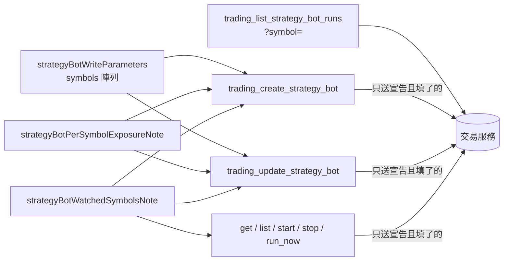

# 一台機器人盯多個交易標的（外掛） — Architecture Design

**Status:** Confirmed
**Source PRD:** `.sdd/2026-10-20-multi-symbol-strategy-bot/PRD.md`
**Tech context:** Go · MCP 外掛 · 能力清單即功能（`cmd/server/tool_catalog*.go` 宣告，`ApiToolDomain` 單一路徑轉達）

---

## 1. Design Goal & Guiding Principle

- **In one sentence:** 建立／改寫機器人把 `symbol`（字串）換成 `symbols`（陣列、必填）；讀執行紀錄多一格可選的 `symbol` 查詢篩選；
  機器人的回覆說明改成講 `watchedSymbols`（每個標的的 `lastSentSignal`／`conflicting`／`haltReason`／合約的 `autoOrderPosition`）與整台停擺 vs 標的停擺；
  改寫說明講「完整清單」語意與兩個 409 `reason`；並把外掛其他地方「一台機器人一個標的」的說法改掉。
- **Guiding principle:** **外掛不懂規則，只懂說明。** 轉達路徑已是「宣告了才送、不填就不送、回覆與拒絕原樣轉交」：
  - 不再宣告 `symbol` → 助理就算填了也不會送出（`ToolArgumentsDomain.EncodedSubset` 只送宣告過的）。這正是「舊寫法不再送出」的機械保證。
  - `symbols` 以陣列原樣（raw JSON）轉送；數量、重複、追蹤名單、槓桿上限都由交易服務判斷，拒絕原話轉交。
  - 409 的 `{"message","reason"}` 原樣當拒絕內容轉交，助理看得到 `watchedSymbolHoldsPosition`／`watchedSymbolAutoOrderOutstanding`。
  - `?symbol=` 只在填了時才放進查詢字串（既有 `queryParameter` 行為），不填即全部標的。
  所以 `internal/` 一行不動；改的全是 `cmd/server/` 的宣告與說明常數，每一段說法只寫一次、由需要它的能力共用。

---

## 2. Change Scope

| Area | Action | What / Why |
| :--- | :--- | :--- |
| `cmd/server/tool_catalog_automation.go` `strategyBotWriteParameters` | **Modify** | `symbol` → `symbols`（`ToolParameterKindArray`、必填）：1–10 個、不得重複（大小寫不同視為同一個）、合約機器人每個都要在追蹤名單、槓桿不得超過任一標的上限（拒絕會點名）、**修改時是完整清單**（留下保留狀態、新加空白、沒列即移除、過去紀錄保留）、移除有持倉／沒做完自動下單的標的整次被拒（兩個 reason） |
| 同檔新常數 `strategyBotWatchedSymbolsNote` | **Add** | 讀機器人回覆的一份說法：`watchedSymbols` 每個標的的欄位、機器人上已不再有 `symbol`／`lastSentSignal`／`conflicting`／`autoOrderPosition`、整台停擺 vs 標的停擺、啟動清狀態不動持倉、對已停止的機器人立刻跑一輪每個標的都跑。掛在 create／update／list／get／start／stop／run-now |
| 同檔新常數 `strategyBotPerSymbolExposureNote` | **Add** | 部位規劃每個標的各自照整份算（總曝險最多 N 倍、沒有同時持倉上限）＋合約機器人開著自動下單時每個監聽標的都會真的下單。掛在 create／update |
| 同檔 `trading_create_strategy_bot`、`trading_update_strategy_bot` 說明 | **Modify** | 「在一個交易標的上」→「在 1–10 個監聽標的上」；update 說明加「`symbols` 是完整清單，只改別的設定也要照抄，漏列就是移除」與兩個 409 reason 的解法（不重送同一份） |
| 同檔 `trading_list_strategy_bot_runs` | **Modify** | 加 `queryParameter("symbol", string, 非必填)`；說明講每筆帶 `symbol`、篩選大小寫不拘、格式不對被拒、輪次編號跨標的不重複、每個標的各記 50 輪、移除的標的紀錄仍在 |
| 同檔 `contractStrategyBotSkippedRoundNote` | **Modify** | 「它的合約標的」→「那個監聽標的」：跳過的只有那個標的那一輪，紀錄看 `symbol` |
| `cmd/server/tool_catalog_strategy.go` `orderFlowReachNote` | **Modify** | 超過訂單流上限「機器人會被停下」→ 那個監聽標的停擺（只盯一個或全部停擺時整台停擺） |
| `cmd/server/tool_catalog_contract.go` `trading_remove_from_contract_watchlist` | **Modify** | 「盯這個合約標的的合約機器人會失明」→ 監聽標的裡有它的合約機器人，只有那個標的每一輪跳過、其他標的照常；看 `watchedSymbols` |
| `cmd/server/tool_catalog_binance_trading_key.go` `autoOrderReallyTradesNote` | **Not touched** | 已經是「合約機器人開著自動下單會真的開倉平倉」，per-symbol 的補充放在 `strategyBotPerSymbolExposureNote`，不動伺服器總說明 |
| 測試 `tool_catalog_contract_strategy_bot_test.go`、`tool_catalog_test.go` | **Modify** | 舊斷言釘的是 `symbol` 一格；改釘 `symbols` |
| 新測試 `tool_catalog_multi_symbol_strategy_bot_test.go` | **Add** | 釘 PRD 情境：`symbols` 陣列原樣轉送、`symbol` 不再送出、`?symbol=` 只在給了時才送、每一段說明的要點 |
| `README.md`、`.sdd/UL-MAP.md` | **Modify** | 合約機器人一節與新詞 |
| `internal/` | **Not touched** | 轉達路徑已滿足；不加檢查（規則屬交易服務） |

---

## 3. New Classes / Modules

無新型別。

| Name | Kind | Responsibility (purpose) | Collaborators | Satisfies (PRD scenario) |
| :--- | :--- | :--- | :--- | :--- |
| `strategyBotWatchedSymbolsNote` | 說明常數 | 一份「機器人回覆裡每個監聽標的怎麼讀、兩種停擺怎麼分」的話，七件回覆機器人的能力共用 | — | US-03 全部、US-02 加一個標的 |
| `strategyBotPerSymbolExposureNote` | 說明常數 | 一份「每個標的各自照整份部位規劃、各自真的下單」的話，建立與改寫共用 | `autoOrderReallyTradesNote` 的語意 | US-01 總曝險提醒、US-05 自動下單涵蓋每個標的 |

---

## 4. Modified Components

| Component | Current role | Change needed |
| :--- | :--- | :--- |
| `strategyBotWriteParameters()` | 建立與改寫共用的欄位 | `symbol` → `symbols` |
| `strategyBotApiTools()` | 九件機器人能力 | 說明、讀紀錄多一格查詢 |
| `contractStrategyBotSkippedRoundNote` | 讀紀錄／立刻跑共用 | 以標的為單位 |
| `orderFlowReachNote` | 訂單流上限說法 | 標的停擺 |
| `trading_remove_from_contract_watchlist` | 移出追蹤名單 | 以監聽標的說 |

---

## 5. Component Relationships

---

## 6. Extensibility & Handoff Notes

- **Most likely next requirement:** 同時持倉上限、或個別標的覆寫部位規劃／槓桿（交易服務 PRD 已列為未來切片）。
- **Where it lands:** 上限是機器人一格新設定 → `strategyBotWriteParameters` 多一格，`strategyBotPerSymbolExposureNote` 改一句「沒有同時持倉上限」；
  個別覆寫多半會把 `symbols` 從字串陣列變成物件陣列 → 只改 `symbols` 那一格的說明與形狀範例，轉達路徑不變（陣列原樣轉送）。
- **How to add it:** 改常數、加一格宣告；轉達路徑不需改。新的 409 reason 加在改寫說明那一段。

---

## 7. Traceability

| PRD scenario | Component |
| :--- | :--- |
| US-01 建立盯兩個標的／只盯一個／正好 10 個 | `symbols` 陣列原樣轉送（測試斷言 body） |
| US-01 超過 10 個／重複／不在追蹤名單 | `symbols` 說明列出拒絕；拒絕原話轉交（既有路徑） |
| US-01 總曝險提醒 | `strategyBotPerSymbolExposureNote` |
| US-02 加一個標的／只改別的設定照抄／移除空手標的 | `symbols` 說明（完整清單語意）＋ update 說明 |
| US-02 移除有持倉／沒做完自動下單 | update 說明兩個 reason＋解法 |
| US-02 舊單一標的寫法不再送出 | 不宣告 `symbol`（測試斷言 body 無 `"symbol"`） |
| US-03 全部 | `strategyBotWatchedSymbolsNote` |
| US-04 只看 ETHUSDT／讀全部 | `trading_list_strategy_bot_runs` 的 `symbol` 查詢（測試斷言 Query） |
| US-04 格式不對 | 說明＋拒絕原話轉交 |
| US-05 移出追蹤名單 | `trading_remove_from_contract_watchlist` 說明 |
| US-05 自動下單涵蓋每個標的 | `strategyBotPerSymbolExposureNote` |
