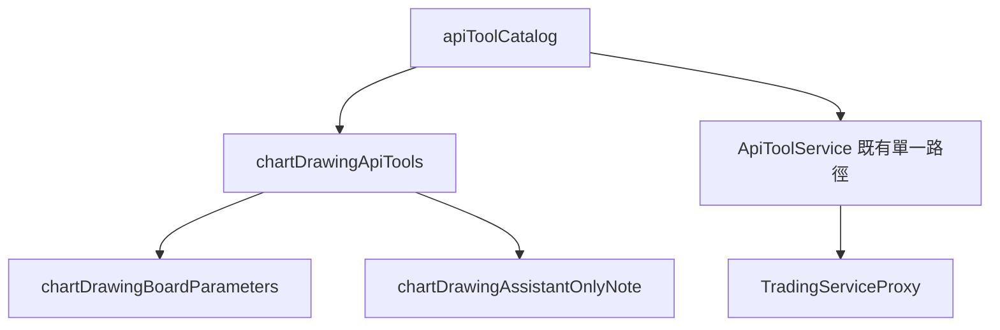

# 助理在使用者的 K 線圖上畫線（外掛）— Architecture Design

**Status:** Confirmed（autonomous run — decisions recorded below）
**Source PRD:** `.sdd/2026-10-21-chart-drawing-abilities/PRD.md`
**Tech context:** Go · MCP 外掛 · 能力清單即功能（`cmd/server/tool_catalog*.go` 宣告，`ApiToolDomain` 單一路徑轉達）· 交易服務路由以 `go-trading/.sdd/2026-10-20-chart-drawing-storage-and-assistant-drawing/` 為準（merge commit 4607537）

---

## 1. Design Goal & Guiding Principle

- **In one sentence:** 新增 `cmd/server/tool_catalog_chart_drawing.go`，宣告三件看盤繪圖能力並接進 `apiToolCatalog`；外掛開場說明與 README 補上「能畫線、只能動助手畫的」。
- **Guiding principle:** **「外掛動不到手畫繪圖」靠的是清單裡不存在整份存回，而不是任何判斷。** 三件能力只是宣告；規則（刻度、對 K 線、吸附、點數、樣式、上限、手畫不能移除）全在交易服務，拒絕由既有的 `TradingServiceProxy` 原話帶回。`internal/` 一行不動。

---

## 2. Change Scope

| Area | Action | What / Why |
| :--- | :--- | :--- |
| `cmd/server/tool_catalog_chart_drawing.go` | **Add** | `chartDrawingApiTools()`：三件能力；共用 `chartDrawingBoardParameters()`（市場＋交易標的兩個網址格子，三件共用）與 `chartDrawingAssistantOnlyNote`（只能動助手畫的、手畫的請使用者自己在網頁上動、沒有修改） |
| `cmd/server/tool_catalog.go` | **Modify** | `apiToolCatalog` 多 append `chartDrawingApiTools()` |
| `cmd/server/dependencies.go` | **Modify** | 外掛開場說明（`Instructions`）補一句能在使用者 K 線圖上畫線、只能動助手畫的、畫完請使用者回網頁看 |
| `cmd/server/tool_catalog_test.go` | **Modify** | 能力總表加三件 |
| `cmd/server/tool_catalog_chart_drawing_test.go` | **Add** | 釘住三件能力的動作、路由、必填、原樣轉送、說明必講的句子；並釘住**沒有任何能力會整份改寫繪圖板** |
| `README.md` | **Modify** | 新增一節「在 K 線圖上畫線」 |
| `internal/**` | **Not touched** | 網址格子跳脫、查詢字串、內文原樣轉送、拒絕原話、401 重新連線都是既有行為 |

---

## 3. New Classes / Modules

沒有新型別，新增三筆宣告：

| 能力名稱 | 動作與路由 | 參數 | Satisfies |
| :--- | :--- | :--- | :--- |
| `trading_get_chart_drawings` | read `/users/me/chart-drawings/{market}/{symbol}` | path `market`✔、`symbol`✔ | US-01 全部 |
| `trading_add_chart_drawings` | submit `/users/me/chart-drawings/{market}/{symbol}/assistant-drawings` | path `market`✔、`symbol`✔；body `interval`✔(string)、`drawings`✔(array) | US-02 全部 |
| `trading_remove_assistant_chart_drawings` | remove `/users/me/chart-drawings/{market}/{symbol}/assistant-drawings` | path `market`✔、`symbol`✔；query `ids`(string，逗號分隔，選填) | US-03 全部 |

決定：
- **`ids` 宣告為字串**（`"12,15"`）：查詢字串由 `ToolArgumentsDomain.PlainTextAt` 讀，陣列會被送成 `[12,15]` 而被交易服務拒絕；字串最貼近交易服務的 `?ids=1,2`，且與 `trading_submit_symbol_screening_run` 的 `symbols` 同一種形狀。不給即不帶查詢字串＝移除助手畫的全部。
- **`drawings` 宣告為 array**，說明以一個完整範例寫出形狀（`kind`、`anchors[{openTime, snapTo|price}]`、`color`、`lineWidth`、`lineStyle`），列出八種種類與點數、十二色、線寬、線型、上限；比照 `firstEntryFill` 以文字描述物件形狀的既有作法（能力欄位的 schema 只有型別與說明）。
- 命名：`get`／`add`／`remove_assistant` 對齊既有 `trading_get_*`、`trading_add_*`、`trading_remove_*`；移除的名稱帶 `assistant`，讓「只能移除助手畫的」連名字都看得到。
- 新增不加 `Waiting`：交易服務一次讀幾根 K 線即回，一般等待時間足夠。

---

## 4. Modified Components

| Component | Current role | Change needed |
| :--- | :--- | :--- |
| `apiToolCatalog` | 組出能力清單 | 多 append 一組 |
| `buildMcpServer` 的 `Instructions` | 外掛開場說明 | 補一段畫線 |

---

## 5. Component Relationships

---

## 6. Extensibility & Handoff Notes

- **Most likely next requirement:** 交易服務開放助手「修改」自己的繪圖，或新增繪圖種類（例如文字標註）。
- **Where it lands:** 修改＝在 `chartDrawingApiTools()` 補一筆，沿用 `chartDrawingBoardParameters()`；新種類＝只改 `drawings` 說明裡的種類清單（一處）。
- **How to add it:** 加宣告、加測試列；不碰 `internal/`。
- **Do not hardcode:** 外掛不檢查刻度、種類、顏色、上限——說明解釋，交易服務把關。
- **Do not add:** 整份存回（`PUT /users/me/chart-drawings/{market}/{symbol}`）。測試守著「沒有能力會整份改寫繪圖板」。
- **Known debt / deferred:** 能力欄位的 schema 不支援 enum／items，物件與列舉形狀只能寫在說明裡（全清單共通的限制，不在此切片處理）。

---

## 7. Traceability

| PRD Scenario | Fulfilled by |
| :--- | :--- |
| US-01 兩種來源都列出並標明來源 | `trading_get_chart_drawings`（路由帶 market／symbol，原樣轉送）＋說明 |
| US-01 從沒畫過的繪圖板是空的一份 | 交易服務；說明寫明 revision 0、空的 drawings |
| US-01 市場說錯由交易服務拒絕並原話帶回 | 既有拒絕轉達；`market` 格子說明寫明 spot／contract |
| US-02 吸附最低價畫一條水平線 | `trading_add_chart_drawings`（interval、drawings 原樣進內文）＋說明（回網頁看） |
| US-02 一次二十個照常送出 | `drawings` 原樣轉送 |
| US-02 時間對不上刻度…原話帶回 | 既有拒絕轉達＋說明（照拒絕改再送） |
| US-02 空位不夠… | 既有拒絕轉達＋說明（上限） |
| US-02 沒說刻度外掛先擋下 | `interval` 必填 → `ErrRequiredArgumentMissing` |
| US-02 說明教會助理畫對 | `trading_add_chart_drawings` 說明與格子說明 |
| US-03 指名移除一條助手畫的 | `trading_remove_assistant_chart_drawings` query `ids` |
| US-03 不指名即移除助手畫的全部 | 不給 `ids` → 不帶查詢字串 |
| US-03 指名到手畫的整次拒絕 | 既有拒絕轉達＋`chartDrawingAssistantOnlyNote` |
| US-03 指名不存在的編號整次拒絕 | 既有拒絕轉達 |
| US-04 能力清單只有看、畫、移除助手畫的三件 | `everyAbilityTheTradingServiceOffers`＋新測試（沒有 replace 繪圖板） |
| US-04 使用者要求改手畫的線 | `chartDrawingAssistantOnlyNote`（沒有修改、請使用者在網頁上動） |
| US-05 開場說明與專案說明提到畫線 | `dependencies.go` Instructions、README |
