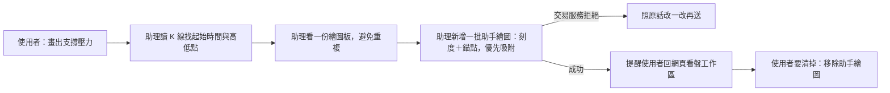

# Product Requirements Document (PRD) — 助理在使用者的 K 線圖上畫線（外掛）

**Status:** Finalized
**Version:** v1.0
**Owner:** James Hsueh
**Stakeholders:** Engineering

---

## 1. Background & Goal (Why & Goal)

- **Problem Statement:** 交易服務已經能替每一位使用者保存**繪圖板**，也給了助手一支只能動助手那一份的筆，
  但 Claude Code 裡的助理碰不到它：使用者說「幫我把這一段的支撐壓力畫出來」，助理讀得懂行情，卻沒有能畫的能力。
- **Expected Outcome:**
  - 外掛多三件**看盤繪圖能力**：看一份繪圖板、在繪圖板上新增一批助手繪圖、移除助手繪圖。
  - 助理照說明就能一次畫對：先讀 K 線找真正的起始時間與高低點、優先用吸附、刻度與時間對齊；被拒時照原話改一改再送。
  - 助理畫完會提醒使用者回到網頁的看盤工作區（或重新聚焦那一頁）就看得到。
  - **外掛沒有任何能改或刪使用者手畫繪圖的能力**——整份存回不在能力清單裡。
- **Out of Scope:**
  - 整份存回繪圖板；修改（移動、改色、鎖定）任何繪圖。
  - 外掛自己檢查繪圖規則、對時間、算吸附價格——全部交給交易服務。
  - 即時推到網頁；新的讀行情能力。

---

## 2. User Personas

- **Primary Role(s):** 使用者（在 Claude Code 裡請助理在他的 K 線圖上畫線、清掉助理畫的線）。
- **Usage Context:** 一邊在網頁開著看盤工作區、一邊在 Claude Code 問行情；助理畫完，使用者切回網頁就看得到。

---

## 3. User Stories & Acceptance Criteria

### US-01 — [priority: P0] 看一份繪圖板
**As a** 使用者, **I want** 助理先看清楚板上已經有哪些線, **so that** 它不會重複畫、也知道哪些是它畫的。

```gherkin
Scenario: 兩種來源都列出並標明來源
  Given 合約 BTCUSDT 的繪圖板上有一條手畫、一條助手畫的線
  When 助理看合約 btcusdt 的繪圖板
  Then 外掛向交易服務讀的是合約市場、交易標的 btcusdt 的那一份繪圖板
  And 帶回的兩條線各自標明手畫或助手、並附繪圖板的版本

Scenario: 從沒畫過的繪圖板是空的一份
  Given 現貨 ETHUSDT 從沒畫過
  When 助理看現貨 ETHUSDT 的繪圖板
  Then 帶回空的一份、版本 0，不是錯誤

Scenario: 市場說錯由交易服務拒絕並原話帶回
  Given 市場說成「期貨」
  When 助理看繪圖板
  Then 帶回交易服務的拒絕原話
  And 看一份繪圖板的說明寫明市場只有現貨與合約兩種
```

### US-02 — [priority: P0] 在繪圖板上新增一批助手繪圖
**As a** 使用者, **I want** 一句話就讓助理把支撐壓力畫在我的圖上, **so that** 不必自己一條一條畫。

```gherkin
Scenario: 吸附最低價畫一條水平線
  Given 一小時刻度在 10/19 08:00 有一根 K 線、最低 61200
  When 助理在合約 BTCUSDT 畫一條水平線，點在 10/19 08:00、吸附最低價、紅色虛線
  Then 外掛把刻度一小時與這一個繪圖原樣交給交易服務的合約 BTCUSDT 繪圖板
  And 帶回新繪圖的編號、價格 61200 與前進後的版本
  And 新增助手繪圖的說明要求助理提醒使用者回到網頁的看盤工作區（或重新聚焦那一頁）才看得到

Scenario: 一次二十個照常送出
  When 助理一次交上 20 個繪圖
  Then 20 個繪圖一個不少地交給交易服務

Scenario: 時間對不上刻度由交易服務整批拒絕並原話帶回
  Given 刻度一小時
  When 助理把點放在 10/19 08:30
  Then 帶回交易服務指出第 1 個繪圖第 1 個點的拒絕原話
  And 新增助手繪圖的說明告訴助理照拒絕說的改一改再送、不要原樣重送

Scenario: 空位不夠由交易服務整批拒絕並說出剩幾個
  Given 繪圖板只剩 10 個空位
  When 助理一次交上 11 個繪圖
  Then 帶回交易服務說出還剩幾個空位的拒絕原話

Scenario: 沒說刻度外掛先擋下
  When 助理沒說刻度就新增
  Then 外掛不送出，回覆刻度是必填

Scenario: 說明教會助理畫對
  When 助理讀新增助手繪圖的說明
  Then 說明寫明先用讀 K 線的能力找真正的起始時間與高低點（現貨板讀現貨 K 線、合約板讀合約 K 線）
  And 寫明時間必須正好是所說刻度上一根已存在 K 線的起始時間、六種刻度
  And 寫明價格與吸附二選一、優先用吸附、吸附的四種價
  And 寫明八種繪圖與各自的點數、十二種線色、線寬 1 到 4、三種線型、樣式可省略
  And 寫明一份最多 200 個、一次最多 20 個
  And 寫明只能新增助手繪圖、新增直接生效不必先問使用者
```

### US-03 — [priority: P0] 只移除助手畫的
**As a** 使用者, **I want** 叫助理清掉它畫的線, **so that** 我的圖不會越堆越亂，而我手畫的永遠不會被它動到。

```gherkin
Scenario: 指名移除一條助手畫的
  Given 板上有 A（手畫）、B、C（助手）
  When 助理指名移除 B
  Then 外掛把「只移除 B」交給交易服務
  And 帶回移除了 1 個

Scenario: 不指名即移除助手畫的全部
  Given 板上只有 A（手畫）
  When 助理不指名、移除全部
  Then 外掛不帶任何編號交給交易服務
  And 帶回移除了 0 個

Scenario: 指名到手畫的整次拒絕
  Given 板上有 A（手畫）、B（助手）
  When 助理指名移除 A、B
  Then 帶回交易服務的拒絕原話，一個都沒刪
  And 移除助手繪圖的說明告訴助理手畫的只能使用者自己在網頁上動、不要改用別的辦法去刪

Scenario: 指名不存在的編號整次拒絕
  When 助理指名一個板上沒有的編號
  Then 帶回交易服務的拒絕原話
```

### US-04 — [priority: P0] 外掛動不到手畫的繪圖
**As a** 使用者, **I want** 助理只能動它自己畫的, **so that** 別人寫的字騙它也刪不到我手畫的線。

```gherkin
Scenario: 能力清單只有看、畫、移除助手畫的三件
  When 列出外掛會做的事
  Then 看盤繪圖能力正好是看一份繪圖板、新增助手繪圖、移除助手繪圖三件
  And 沒有任何一件會整份存回或改動繪圖板

Scenario: 使用者要求改手畫的線
  Given 使用者要助理把他畫的趨勢線移到 62000
  When 助理找能力
  Then 看盤繪圖能力的說明告訴助理沒有修改的能力、手畫的請使用者自己在網頁上動
```

### US-05 — [priority: P1] 外掛的自我介紹提到畫線
**As a** 使用者, **I want** 助理一開始就知道外掛能畫線, **so that** 我說「畫出來」時它會用這幾件能力。

```gherkin
Scenario: 開場說明與專案說明提到畫線
  When 助理讀外掛的開場說明
  Then 說明提到能在使用者的 K 線圖上畫線、只能動助手畫的
  And 專案說明文件列出三件看盤繪圖能力
```

---

## 4. Business Flow & Logic



- **Core Business Rules:**
  - 外掛只轉達：市場、交易標的放在指名繪圖板的位置；刻度與繪圖原樣交給交易服務；要移除的編號原樣交給交易服務。
  - 規則（刻度、對時間、點數、樣式、上限、手畫不能移除）全由交易服務決定；拒絕照原話帶回。
  - 外掛唯一自己擋的是**必填**：市場、交易標的；新增時的刻度與繪圖。
- **Edge Cases:**
  - 連不到交易服務：照既有說法「連不到交易服務」，不說成使用者做錯。
  - 外掛授權失效：照既有說法請使用者到 Claude Code 外掛選單重新連線。

---

## 5. UI/UX Design & Interaction

- N/A（外掛沒有畫面；使用者在網頁的看盤工作區回到頁面或重新聚焦時看到新畫的線）。

---

## 6. Non-Functional Requirements

- **Security:** 每一件都以呼叫端帶來的外掛授權進行，沒有欄位可以指定別人；整份存回不在能力清單裡。
- **Performance:** 一般等待時間即可。

---

## 7. Dependencies & Risks

- **External Dependencies:** 交易服務的看盤繪圖功能必須已經上線，外掛才能合併上線。
- **Known Risks:** 助理編造時間或價位——以說明引導先讀 K 線、優先吸附，最後由交易服務對 K 線把關。

---

## 8. Appendix

- 交易服務：`go-trading` 的「看盤繪圖存到服務裡，並讓助手能在 K 線圖上畫線」切片。
- 網頁：`go-trading-frontend` 的看盤工作區切片。
