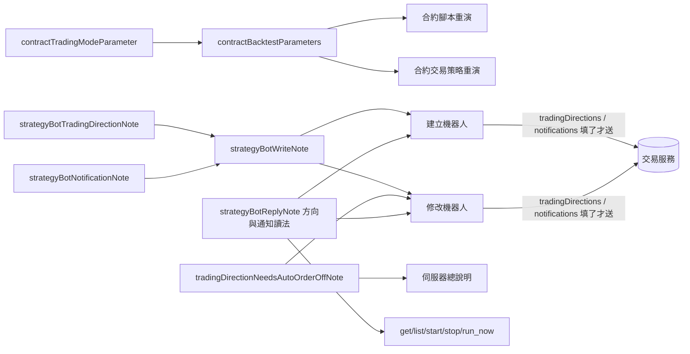

# 交易方向從交易策略搬到機器人與回測（外掛） — Architecture Design

**Status:** Confirmed
**Source PRD:** `.sdd/2026-11-11-bot-trading-direction/PRD.md`
**Tech context:** Go · MCP 外掛 · 能力清單即功能（`cmd/server/tool_catalog*.go` 宣告，`ApiToolDomain` 單一路徑轉達）

---

## 1. Design Goal & Guiding Principle

- **In one sentence:** 交易策略的兩件寫入拿掉 `tradingMode` 這一格；`tradingMode` 從「只有合約腳本重演才有」改成**兩件合約重演共用**；
  策略機器人的兩件寫入多兩格 `tradingDirections`（`["long","short"]`）與 `notifications`（`{buy,sell,hold}`）；回覆機器人的能力說得出兩者；
  修改機器人與伺服器總說明說清楚「自動下單開著時改不了方向，而外掛關不了自動下單」。
- **Guiding principle:** **外掛不懂規則，只懂說明——而且一段話只寫一次。** 宣告的格子由 `ToolArgumentsDomain.EncodedSubset` 只送「宣告過且填了的」，
  所以拿掉格子＝外掛再也送不出它（交易服務那一頭會拒絕的東西，助理根本看不到）；新格子不給即不送，交易服務自己套預設或保留。
  **`internal/` 一行不動**。

---

## 2. Change Scope

| Area | Action | What / Why |
| :--- | :--- | :--- |
| `tool_catalog_strategy.go` `tradingStrategyWriteParameters` | **Modify** | 刪 `tradingMode` 格（交易服務送來即整份拒絕；格子在，助理就會填） |
| 同檔 `tradingStrategyApiTools` 的建立／查看／修改說明 | **Modify** | 拿掉「記著自己的交易模式」「例外是 marketDataKind 與 tradingMode」；改說方向在機器人（交易方向）與回測（交易模式），同一份交易策略可同時養做多與做空的機器人 |
| 同檔 `contractBacktestParameters` | **Modify** | 收進 `tradingMode`（`contractTradingModeParameter`）：兩件合約重演現在都由這一次說；`trading_backtest_contract_strategy_script` 拿掉自己那一格（改由共用清單帶） |
| 同檔 `trading_backtest_contract_trading_strategy` 說明 | **Modify** | 「沒有 tradingMode 那一格、要換改交易策略」改成「交易模式由這一次說，不給即多空反手，成績單記著」 |
| 同檔 `trading_backtest_contract_strategy_script` 說明 | **Modify** | 交易模式那一句搬進共用說明 `contractTradingModeNote`，兩件共用 |
| `tool_catalog_automation.go` `strategyBotWriteParameters` | **Modify** | 加 `tradingDirections`（array）、`notifications`（object）兩格，選填 |
| 同檔新常數 `strategyBotTradingDirectionNote` | **Add** | 方向的意思、預設、現貨沒有、改方向的三道限制（含外掛關不了自動下單）；掛在建立／修改 |
| 同檔新常數 `strategyBotNotificationNote` | **Add** | 三個開關、預設、修改時沒說的保留、關通知不影響信號／去重／自動下單、回到持有、三個都關；掛在建立／修改 |
| 同檔 `strategyBotReplyNote`（經 `strategyBotWatchedSymbolsNote` 旁新增一段） | **Modify** | 回覆帶 `tradingDirections`（合約）與 `notifications` 的讀法；七件回覆機器人的能力共用 |
| 同檔 `trading_create_strategy_bot` 說明 | **Modify** | 「每一輪照那份交易策略的交易模式說出…」改成「照這台機器人的交易方向」 |
| 同檔 `trading_update_strategy_bot` 說明 | **Modify** | 「例外有三樣」→ 五樣（加交易方向、通知）；改方向被拒的 reason：`tradingDirectionAutoOrderOn`、`watchedSymbolHoldsPosition`、`watchedSymbolAutoOrderOutstanding` |
| `tool_catalog_binance_trading_key.go` 新常數 `tradingDirectionNeedsAutoOrderOffNote` | **Add** | 「外掛改不了開著自動下單的機器人的方向，請使用者到網頁先關」一句；修改機器人與伺服器總說明共用 |
| `dependencies.go` 伺服器總說明 | **Modify** | 接上 `tradingDirectionNeedsAutoOrderOffNote` |
| 測試 | **Modify/Add** | 改掉釘舊說法的斷言（`tool_catalog_contract_backtest_test.go`、`tool_catalog_contract_strategy_bot_test.go`）；新增 `tool_catalog_bot_trading_direction_test.go` 釘 PRD 情境 |
| `README.md`、`.sdd/UL-MAP.md` | **Modify** | 換掉「交易模式記在交易策略上」（UL-MAP 已在 PRD 階段更新） |
| `tool_catalog_symbol_screening.go` | **Not touched** | 篩選設定照舊自己說交易模式 |
| 兩件現貨重演 | **Not touched** | 照舊沒有交易模式（`TestNoAbilityOffersATradingModeToChoose` 繼續釘） |
| `internal/` | **Not touched** | 轉達路徑已滿足 |

---

## 3. New Classes / Modules

無新型別，只有說明常數與一個共用格子。

| Name | Kind | Responsibility (purpose) | Collaborators | Satisfies (PRD scenario) |
| :--- | :--- | :--- | :--- | :--- |
| `contractTradingModeParameter` | 共用格子（函式回傳 `ToolParameterVo`） | 合約重演「這一次照哪個方向交易」的唯一一格 | `contractBacktestParameters` | US-05 回測只做空／沒說方向 |
| `contractTradingModeNote` | 說明常數 | 兩件合約重演對交易模式的同一段話（三種、預設、沒有 spot、成績單記著） | 兩件合約重演 | US-05 |
| `strategyBotTradingDirectionNote` | 說明常數 | 交易方向的意思與限制 | `strategyBotWriteNote` | US-02、US-03 |
| `strategyBotNotificationNote` | 說明常數 | 三種結論通知的意思 | `strategyBotWriteNote` | US-04 |
| `tradingDirectionNeedsAutoOrderOffNote` | 說明常數 | 外掛改不了開著自動下單的機器人方向 | 修改機器人、伺服器總說明 | US-03 自動下單開著時改方向 |

---

## 4. Modified Components

| Component | Current role | Change needed |
| :--- | :--- | :--- |
| `tradingStrategyWriteParameters` | 交易策略的格子 | 刪 `tradingMode` |
| `contractBacktestParameters` | 兩件合約重演共用的帳戶格子 | 加 `tradingMode`（現在兩件都收） |
| `strategyBotWriteParameters` | 機器人的格子 | 加 `tradingDirections`、`notifications` |
| `strategyBotReplyNote` | 回覆機器人的讀法 | 加方向與通知的讀法 |
| `strategyBotWriteNote` | 建立與修改共用的尾段 | 加方向與通知兩段 |
| 伺服器總說明 | 外掛規矩 | 加改方向的限制 |

---

## 5. Component Relationships

---

## 6. Extensibility & Handoff Notes

- **Most likely next requirement:** 逐種結論決定自動下單，或第四種通知（例如衝突通知）。
- **Where it lands:** `notifications` 物件多一個鍵——外掛的格子是物件，原樣轉送，不必新宣告；只改 `strategyBotNotificationNote` 與 `notifications` 格子說明的形狀。
- **How to add it:** 改常數；不需要 `internal/` 改動。新的拒絕原因不必預先寫（原話轉交），只寫助理要預先知道、外掛又做不到的那種（像自動下單只能在網頁上）。
- **Do not hardcode:** 外掛不替助理填任何預設（方向兩者、通知買入賣出開）——不給就不送，預設只住在交易服務。

---

## 7. Traceability

| PRD Scenario | Fulfilled by |
| :--- | :--- |
| US-01 建立合約交易策略不提交易方向 | `tradingStrategyWriteParameters` 無 `tradingMode`（測試斷言格子不在、body 無 `tradingMode`） |
| US-01 使用者要求交易策略只做多 | 建立交易策略說明（方向在機器人與回測） |
| US-01 修改時仍送交易模式被拒 | 格子已刪（送不出）；拒絕原話轉交（既有路徑）；修改說明不再寫保留交易模式 |
| US-01 讀交易策略看不到交易模式 | 查看交易策略說明 |
| US-02 建立時選做多 | `tradingDirections` 格子原樣轉送 |
| US-02 建立時沒說方向 | 不給不送；`strategyBotTradingDirectionNote` 說預設兩者 |
| US-02 一個方向都沒選 | `strategyBotTradingDirectionNote`／格子說明「至少一個」；空陣列原樣轉送 |
| US-02 現貨機器人送來方向 | 格子說明「只有合約機器人」 |
| US-02 同一份交易策略兩台方向不同 | `strategyBotTradingDirectionNote` 的對照 |
| US-02 只改名字時方向保留 | 修改說明「例外有五樣」 |
| US-02 讀機器人看得到方向 | `strategyBotReplyNote` |
| US-03 安全時改方向 | `tradingDirections` 原樣轉送（update） |
| US-03 自動下單開著時改方向 | `tradingDirectionNeedsAutoOrderOffNote`（修改說明＋總說明）＋ reason `tradingDirectionAutoOrderOn` |
| US-03 監聽標的還有機器人持倉／沒做完的自動下單 | 修改說明 reason 段落 |
| US-03 方向不變只改間隔 | `strategyBotTradingDirectionNote`（方向沒變不受限）＋ 不給不送 |
| US-03 執行中改方向或通知 | 修改說明（既有「只有已停止的機器人改得動」） |
| US-04 關掉買入通知 | `notifications` 原樣轉送；`strategyBotNotificationNote` 沒說的保留 |
| US-04 建立時沒提通知 | `strategyBotNotificationNote` 預設 |
| US-04 關掉通知仍會下單 | `strategyBotNotificationNote` |
| US-04 回到持有／連續持有／三個都關 | `strategyBotNotificationNote` |
| US-04 讀機器人看得到通知 | `strategyBotReplyNote` |
| US-05 回測只做空／沒說方向 | `contractTradingModeParameter` 在 `contractBacktestParameters`；`contractTradingModeNote` |
| US-05 現貨交易策略回測說方向 | 現貨重演照舊無此格（既有測試）＋ `spotOnlyReplayNote` |
| US-05 標的篩選設定不受影響 | `symbolScreeningProfileWriteParameters` 不動（測試斷言仍有 `tradingMode`） |
