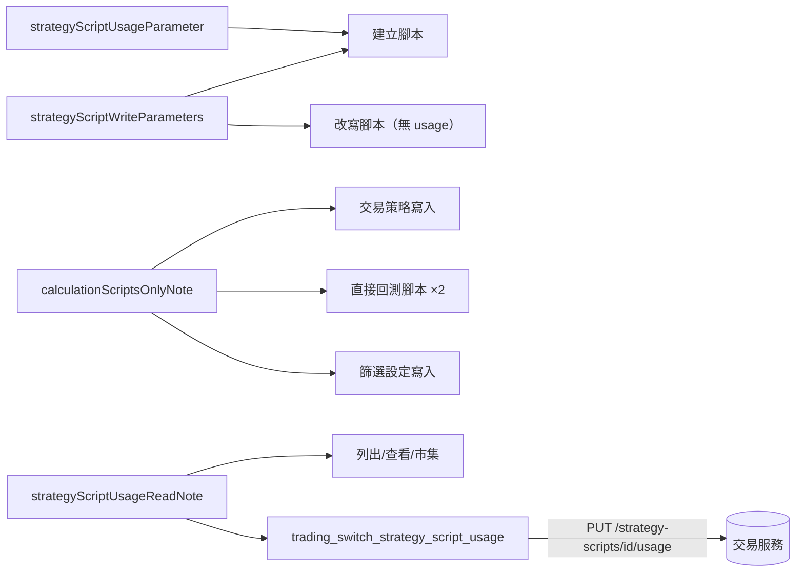

# 策略腳本的用途（外掛） — Architecture Design

**Status:** Confirmed
**Source PRD:** `.sdd/2026-11-11-strategy-script-usage/PRD.md`
**Tech context:** Go · MCP 外掛 · 能力清單即功能（`cmd/server/tool_catalog*.go` 宣告，`ApiToolDomain` 單一路徑轉達）

---

## 1. Design Goal & Guiding Principle

- **In one sentence:** 建立策略腳本多一格 `usage`（`chart`／`calculation`，不給不送）；改寫腳本**不**宣告它；
  新增一件 `trading_switch_strategy_script_usage`（`PUT /strategy-scripts/{id}/usage`，內文只有必填的 `usage`）；
  讀腳本、列腳本、市集、交易策略、篩選設定、直接回測腳本的說明各自說出用途的意思與「只接受計算用」。
- **Guiding principle:** 建立與改寫目前共用 `strategyScriptWriteParameters`；用途只屬於建立，所以**加在建立那一端**，不放進共用清單——
  共用清單一旦帶著它，改寫就會送出交易服務必拒的東西。「只接受計算用」是**一句話寫一次**（`calculationScriptsOnlyNote`），由需要的每一件能力共用。
  **`internal/` 一行不動**：新能力只是清單裡多一筆，路徑與轉送走既有的單一路徑。

---

## 2. Change Scope

| Area | Action | What / Why |
| :--- | :--- | :--- |
| `tool_catalog_strategy.go` `trading_create_strategy_script` | **Modify** | 參數＝共用清單 ＋ `strategyScriptUsageParameter`；說明加用途 |
| 同檔 `trading_update_strategy_script` | **Modify** | 參數不變（不帶用途）；說明加「改寫不動用途，要改用 trading_switch_strategy_script_usage」 |
| 同檔新能力 `trading_switch_strategy_script_usage` | **Add** | `RequestVerbReplace` `/strategy-scripts/{id}/usage`，`id`（path）＋ `usage`（body，必填）；說明：自己的與市集副本都能切、切成圖表用時被引用即拒（reason `strategyScriptUsageInUse`、說出是哪幾份）、切成計算用無限制、同用途不變、別人的同找不到、回覆是切換後的腳本、圖表指標選單只列圖表用 |
| 同檔 list／get／browse／adopt 說明 | **Modify** | 每一支帶 `usage`；副本帶加入當下的用途、之後不受發佈者影響 |
| 同檔交易策略建立／修改（`ownStrategyScriptsOnlyNote` 旁） | **Modify** | 加 `calculationScriptsOnlyNote` |
| 同檔 `trading_backtest_strategy_script`、`trading_backtest_contract_strategy_script` 的 `strategyScriptId` 格 | **Modify** | 指名的必須是計算用；自帶算式不受影響 |
| `tool_catalog_symbol_screening.go` `strategyScriptId` 格 | **Modify** | 必須是計算用 |
| `tool_catalog_market.go` 兩件算指標 | **Modify** | 一句「兩種用途都能算」 |
| `tool_catalog_test.go` `everyAbilityTheTradingServiceOffers` | **Modify** | 加 `trading_switch_strategy_script_usage` |
| 新測試 `tool_catalog_strategy_script_usage_test.go` | **Add** | 釘 PRD 情境 |
| `README.md` | **Modify** | 用途一節 |
| `internal/` | **Not touched** | 單一路徑已滿足 |

---

## 3. New Classes / Modules

| Name | Kind | Responsibility (purpose) | Collaborators | Satisfies (PRD scenario) |
| :--- | :--- | :--- | :--- | :--- |
| `strategyScriptUsageParameter` | 格子函式 | 建立時的 `usage` 一格（選填，不給即計算用） | `trading_create_strategy_script` | US-01 |
| `trading_switch_strategy_script_usage` | 能力 | 切換用途 | 既有 `ApiToolDomain` 路徑 | US-02 |
| `calculationScriptsOnlyNote` | 說明常數 | 「只有計算用能當信號來源、篩選、直接回測；圖表用被拒，可先切」 | 交易策略寫入、兩件直接回測腳本、篩選設定寫入 | US-03 |
| `strategyScriptUsageReadNote` | 說明常數 | 讀到的 `usage` 是什麼、圖表選單只列圖表用、升級前的都是計算用 | list／get／browse／switch | US-04 |

---

## 4. Modified Components

| Component | Current role | Change needed |
| :--- | :--- | :--- |
| `strategyScriptApiTools` | 腳本與市集能力 | 建立多一格、改寫說明、新增切換、讀取說明 |
| `tradingStrategyApiTools` | 交易策略能力 | 加 `calculationScriptsOnlyNote` |
| 兩件直接回測腳本、篩選設定 | `strategyScriptId` 格 | 加計算用要求 |
| 兩件算指標 | 說明 | 加兩種用途都能算 |

---

## 5. Component Relationships

---

## 6. Extensibility & Handoff Notes

- **Most likely next requirement:** 第三種用途，或另一個只接受某種用途的地方。
- **Where it lands:** 新用途＝改 `strategyScriptUsageParameter` 與切換能力的格子說明各一句；新消費端＝在它的說明接上 `calculationScriptsOnlyNote`（或同層新增一個 `chartScriptsOnlyNote`）。
- **Do not hardcode:** 外掛不替助理填計算用——不給就不送，預設只住在交易服務。

---

## 7. Traceability

| PRD Scenario | Fulfilled by |
| :--- | :--- |
| US-01 建立圖表用腳本 | `strategyScriptUsageParameter` 原樣轉送 |
| US-01 建立時沒說用途 | 不給不送；格子說明「不給即計算用」 |
| US-01 用途不在兩種之內 | 格子說明列兩種；拒絕原話轉交 |
| US-01 改寫內容不帶用途 | 改寫能力不宣告 `usage`（測試斷言格子不在、body 無 `usage`）；改寫說明 |
| US-02 沒人在用的腳本切成圖表用 | 切換能力：`PUT /strategy-scripts/{id}/usage`，body 只有 `usage` |
| US-02 交易策略／篩選設定在用時不能切 | 切換說明（reason `strategyScriptUsageInUse`、說出是哪幾份、不要重送）；原話轉交 |
| US-02 圖表用切回計算用／切成原本的用途／市集副本／別人的腳本 | 切換說明 |
| US-03 圖表用的腳本當信號來源 | `calculationScriptsOnlyNote` 於交易策略寫入 |
| US-03 篩選設定指名圖表用的腳本 | 篩選 `strategyScriptId` 格說明 |
| US-03 直接回測圖表用的腳本 | 兩件直接回測 `strategyScriptId` 格說明 |
| US-03 試算不受用途影響 | 兩件算指標說明 |
| US-04 查看與列出腳本 | `strategyScriptUsageReadNote` |
| US-04 市集帶著用途 | browse／adopt 說明 |
| US-04 圖表上找不到我的指標 | `strategyScriptUsageReadNote`（切換與列出共用） |
